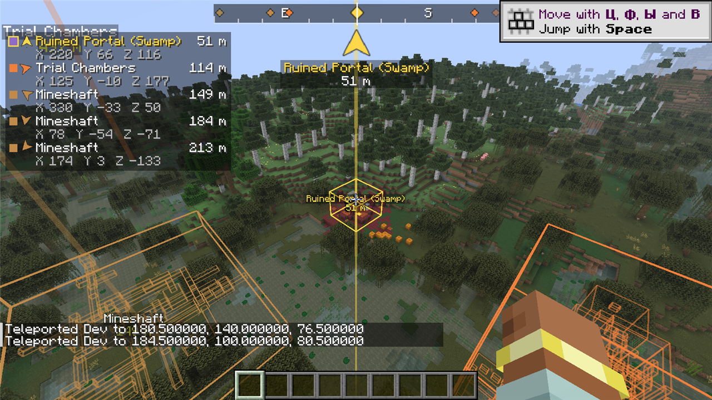
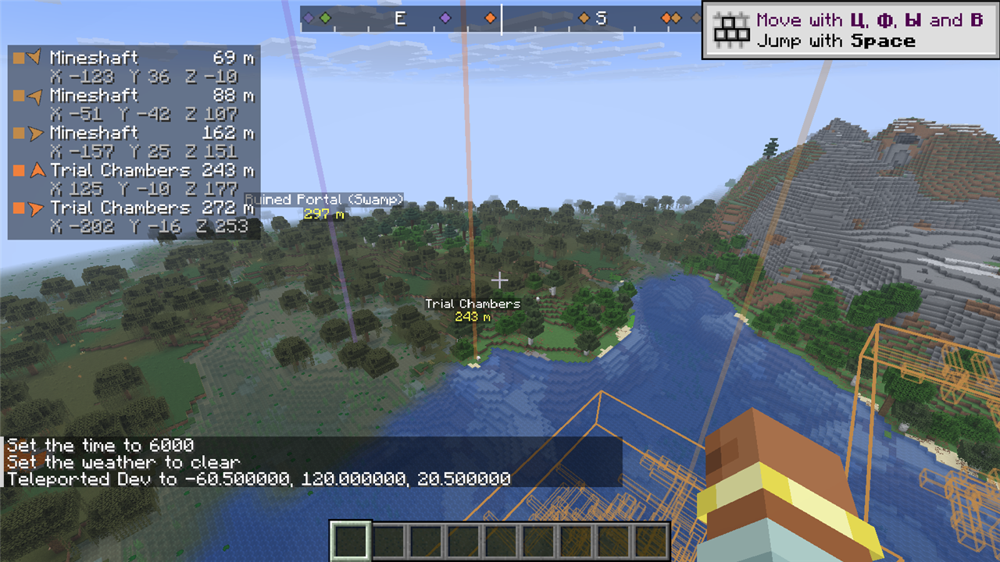
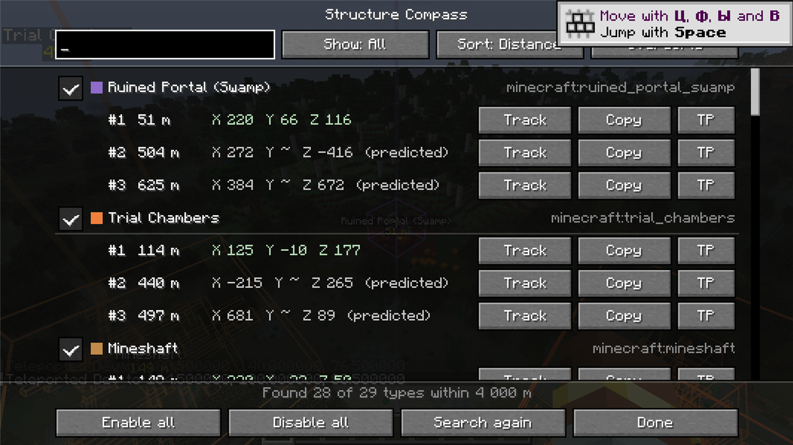
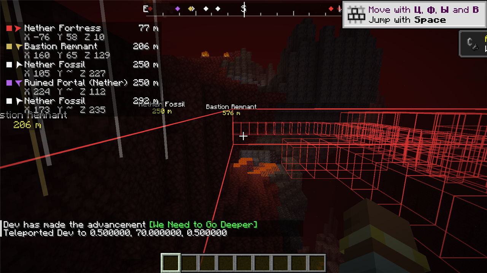

# Structure Compass

[](https://github.com/alien2003/structure-compass/actions/workflows/build.yml)
[](https://github.com/alien2003/structure-compass/releases)


**[Русский](#русский) · [English](#english)**



---

## Русский

Structure Compass показывает ближайшие структуры: где они, куда идти, сколько метров и какие координаты, и
подсвечивает их прямо в мире. Мод для **одиночной игры** на Minecraft **1.21.11** и **NeoForge 21.11.48+**.

### Возможности

- **Все структуры мира** — список берётся из реестра структур текущего мира: ванильные (деревни, древний город,
  камеры испытаний, крепость, особняк, монумент, аванпост, бастион, крепость Нижнего мира, город Края, храмы,
  корабли, порталы, руины троп, шахты и т. д.), из датапаков и других модов. Ничего не захардкожено.
- **Несколько ближайших экземпляров** каждого типа (по умолчанию 3) в настраиваемом радиусе, отдельно для каждого
  измерения.
- **Без лагов.** Поиск идёт в фоновом потоке и повторяет логику генерации мира (`ChunkGenerator#createStructures`):
  random spread и concentric rings, частота, зоны исключения, взвешенный выбор в наборах из нескольких структур.
  Чанки не загружаются и не генерируются, результаты кэшируются, пересчёт — при заметном перемещении и смене
  измерения.
- **Реальные границы** (общая и по частям) для уже сгенерированных структур в загруженных чанках. Неверные прогнозы
  отбрасываются, как только чанк загружен.
- **HUD**: N ближайших структур — цвет типа, название, расстояние в метрах, X/Y/Z (Y — `~`, пока структура не
  сгенерирована), стрелка направления относительно взгляда. Полоса-компас вверху экрана с метками структур и крупная
  стрелка отслеживаемой цели.
- **Подсветка в мире**: лучи и подписи (название + расстояние), видимые сквозь блоки и на большой дистанции (метка
  прижимается к границе видимости), контуры сгенерированных структур рядом — сквозь стены, цвет по типу.
- **Экран структур** (`K`): поиск, фильтр, сортировка по расстоянию/названию, выбор измерения, включение и выключение
  каждого типа, «Следить», «Копировать» координаты, телепорт — только при включённых читах.
- **Настройки** через стандартный экран NeoForge (Моды → Structure Compass → Настройки).
- **Локализация**: русский и английский; для структур других модов — читаемое имя из идентификатора.
- На чужом сервере без мода клиентская часть тихо отключается с одним сообщением в чате.

### Установка

1. Установите [NeoForge](https://neoforged.net/) **21.11.48** или новее для Minecraft **1.21.11**.
2. Скачайте `structurecompass-neoforge-1.21.11-<версия>.jar` со страницы
   [Releases](https://github.com/alien2003/structure-compass/releases) и положите в папку `mods`.
3. Запустите игру и создайте/загрузите одиночный мир.

### Клавиши (меняются в «Настройки → Управление → Привязки клавиш»)

| Клавиша | Действие |
|---|---|
| `K` | Открыть список структур |
| `H` | Вкл/выкл HUD |
| `J` | Вкл/выкл подсветку в мире |
| `G` | Отслеживать следующую структуру (по кругу: ближайшая → следующая → выкл) |

### Настройки (`config/structurecompass-client.toml`)

| Раздел | Параметр | По умолчанию | Описание |
|---|---|---|---|
| search | `radius` | 4000 | Радиус поиска, блоков (256–32000) |
| search | `resultsPerType` | 3 | Ближайших экземпляров на тип (1–10) |
| search | `rescanDistance` | 128 | Повторный поиск после перемещения на N блоков |
| hud | `enabled`, `entries`, `anchor`, `offsetX`, `offsetY`, `scale` | вкл, 5, TOP_LEFT, 4, 24, 1.0 | Панель HUD: строк, угол, отступы, масштаб |
| hud | `showCoordinates`, `backgroundOpacity` | вкл, 0.45 | Координаты под названием, непрозрачность фона |
| hud | `compassBar`, `compassBarWidth`, `compassBarRange` | вкл, 0.4, 90 | Полоса-компас: ширина (доля экрана), охват в градусах |
| world | `enabled`, `beams`, `labels`, `boxes`, `pieceBoxes` | все вкл | Что рисовать в мире |
| world | `boxDistance` | 192 | Дальность подсветки контуров, блоков |
| world | `markerDistance`, `maxMarkers` | 0 (весь радиус), 8 | Дальность и максимум лучей/подписей |
| colors | `trackedColor`, `textColor`, `typeColors` | `#FFD84A`, `#FFFFFF`, — | Цвета; `typeColors` — список `id=#RRGGBB` |
| filter | `disabledTypes` | — | Скрытые типы (удобнее менять на экране `K`) |

### Сборка из исходников

Всё (JDK, Gradle, кэши, артефакты Minecraft, временные файлы) хранится внутри папки проекта.
Нужен только [mise](https://mise.jdx.dev/) — если его нет в `PATH`, обёртки скачают локальную копию в `.tools/bin`.

```bash
git clone https://github.com/alien2003/structure-compass.git
cd structure-compass
./dev build                 # Windows: dev.cmd build
```

Готовый jar: `build/libs/structurecompass-neoforge-1.21.11-<версия>.jar`.

Полезные задачи:

```bash
./dev runClient             # клиент для разработки
./dev runGameTestServer     # headless-прогон GameTest'ов (выход с кодом = числу упавших тестов)
./dev runClientSmokeTest    # визуальный смоук-тест: создаёт мир и делает скриншоты в run/smoketest/screenshots
./dev test                  # юнит-тесты
```

`./dev` и `dev.cmd` выставляют `MISE_DATA_DIR`, `MISE_CACHE_DIR`, `MISE_STATE_DIR`, `MISE_TMP_DIR`,
`MISE_CONFIG_DIR` в `.tools/mise/…`, временные файлы — в `.tools/tmp`, а `mise.toml` задаёт
`GRADLE_USER_HOME=.gradle-home`.

### Ограничения

- Только одиночная игра (и игроки в LAN на вашем мире). На выделенном сервере поиск отключён.
- Для ещё не сгенерированных структур позиция — точка генерации стартовой части, Y неизвестен (`~`). Точные
  координаты центра и границы появляются, когда чанк структуры загружен.
- Подробнее — в [docs/KNOWN_ISSUES.md](docs/KNOWN_ISSUES.md).

---

## English

Structure Compass shows the nearest structures — where they are, which way to go, how many meters, their
coordinates — and highlights them in the world. A **single-player** mod for Minecraft **1.21.11** and
**NeoForge 21.11.48+**.

### Features

- **Every structure of the world** — taken from the world's structure registry: vanilla (villages, ancient cities,
  trial chambers, strongholds, mansions, monuments, outposts, bastions, nether fortresses, end cities, temples,
  shipwrecks, ruined portals, trail ruins, mineshafts...), datapacks and other mods. Nothing is hard-coded.
- **Several nearest instances** per type (3 by default) within a configurable radius, separately for every dimension.
- **No lag.** The search runs on a background thread and mirrors world generation (`ChunkGenerator#createStructures`):
  random-spread and concentric-ring placements, frequency, exclusion zones and the weighted choice inside structure
  sets. It never loads or generates chunks, caches results and re-searches after you move far enough or change
  dimension.
- **Real bounding boxes** (overall and per piece) for generated structures in loaded chunks; wrong predictions are
  dropped as soon as the chunk loads.
- **HUD**: the N nearest structures with type color, name, distance in meters, X/Y/Z (`~` for Y until generated) and a
  direction arrow relative to where you look; a compass bar with structure markers; a large arrow for the tracked
  structure.
- **In-world highlights**: beams and labels (name + distance) visible through blocks and at any distance (pinned to
  the edge of the visible range), outline boxes of generated structures nearby, through walls, colored by type.
- **Structure screen** (`K`): search, filter, sort by distance/name, dimension selector, per-type on/off, Track,
  Copy coordinates, and a teleport button only when cheats are enabled.
- **Config** through the standard NeoForge config screen (Mods → Structure Compass → Config).
- **Translations**: English and Russian; readable fallback names for structures from other mods.
- On a server without the mod the client part disables itself with a single chat message.

### Installation

1. Install [NeoForge](https://neoforged.net/) **21.11.48** or newer for Minecraft **1.21.11**.
2. Download `structurecompass-neoforge-1.21.11-<version>.jar` from
   [Releases](https://github.com/alien2003/structure-compass/releases) into your `mods` folder.
3. Start the game and create/load a single-player world.

### Keys (rebind in Options → Controls → Key Binds)

| Key | Action |
|---|---|
| `K` | Open the structure list |
| `H` | Toggle the HUD |
| `J` | Toggle world highlights |
| `G` | Track the next structure (nearest → next → off) |

### Configuration (`config/structurecompass-client.toml`)

| Section | Option | Default | Meaning |
|---|---|---|---|
| search | `radius` | 4000 | Search radius in blocks (256–32000) |
| search | `resultsPerType` | 3 | Nearest instances per type (1–10) |
| search | `rescanDistance` | 128 | Search again after moving this many blocks |
| hud | `enabled`, `entries`, `anchor`, `offsetX`, `offsetY`, `scale` | on, 5, TOP_LEFT, 4, 24, 1.0 | HUD panel rows, corner, offsets, scale |
| hud | `showCoordinates`, `backgroundOpacity` | on, 0.45 | Coordinates under names, background opacity |
| hud | `compassBar`, `compassBarWidth`, `compassBarRange` | on, 0.4, 90 | Compass bar: width (fraction of screen), degrees covered |
| world | `enabled`, `beams`, `labels`, `boxes`, `pieceBoxes` | all on | What is drawn in the world |
| world | `boxDistance` | 192 | Outline boxes are drawn within this many blocks |
| world | `markerDistance`, `maxMarkers` | 0 (whole radius), 8 | Range and maximum number of beams/labels |
| colors | `trackedColor`, `textColor`, `typeColors` | `#FFD84A`, `#FFFFFF`, — | Colors; `typeColors` is a list of `id=#RRGGBB` |
| filter | `disabledTypes` | — | Hidden types (easier to change in the `K` screen) |

### Building from source

Everything (JDK, Gradle, caches, Minecraft artifacts, temp files) stays inside the project folder. You only need
[mise](https://mise.jdx.dev/); if it is not on `PATH`, the wrappers download a private copy into `.tools/bin`.

```bash
git clone https://github.com/alien2003/structure-compass.git
cd structure-compass
./dev build                 # Windows: dev.cmd build
```

The jar is written to `build/libs/structurecompass-neoforge-1.21.11-<version>.jar`.

Useful tasks:

```bash
./dev runClient             # development client
./dev runGameTestServer     # headless game tests (exit code = number of failed tests)
./dev runClientSmokeTest    # visual smoke test: creates a world and saves screenshots to run/smoketest/screenshots
./dev test                  # unit tests
```

`./dev` and `dev.cmd` point `MISE_DATA_DIR`, `MISE_CACHE_DIR`, `MISE_STATE_DIR`, `MISE_TMP_DIR` and
`MISE_CONFIG_DIR` into `.tools/mise/…` and temp files into `.tools/tmp`; `mise.toml` sets
`GRADLE_USER_HOME=.gradle-home`.

### Limitations

- Single-player only (plus LAN guests on your world). Structure search is disabled on dedicated servers.
- For structures that are not generated yet, the position is the generation point of the start piece and Y is
  unknown (`~`). The exact centre and boxes appear once the structure's chunk is loaded.
- See [docs/KNOWN_ISSUES.md](docs/KNOWN_ISSUES.md) for details.

### Screenshots

| HUD, beams and labels | Structure screen (`K`) |
|---|---|
|  |  |
| **Nether: fortress boxes through walls** | **Tracked structure** |
|  |  |

The screenshots are produced automatically by `./dev runClientSmokeTest` (seed 20261109).

### License

[MIT](LICENSE)
